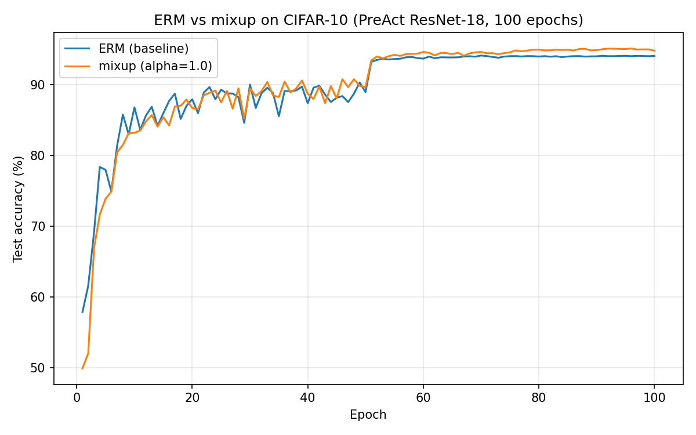

# mixup-reproduction

A PyTorch reproduction of **mixup: Beyond Empirical Risk Minimization** (Zhang et al., ICLR 2018) on CIFAR-10 with PreAct ResNet-18 — the experiment in Figure 3a of the paper.

This is a coursework reproduction project. Its goal is to verify the paper's core claim (mixup beats ERM) and its regularization effect, not to chase state-of-the-art numbers. Training was shortened to 100 epochs (paper: 200); all deviations from the paper are stated openly below.

## Results

| Run | Best test acc. | Final test acc. | Best test error | Final train_loss | Paper (200 epochs) |
|---|---|---|---|---|---|
| ERM baseline (α=0) | 94.16% | 94.10% | 5.84% | 0.0023 | 94.4% (error 5.6%) |
| mixup (α=1.0) | **95.16%** | 94.84% | **4.84%** | 0.8358 | 95.8% (error 4.2%) |

**Finding:** mixup is **+1.00 percentage point** above ERM (paper: +1.4 with twice the training) — same direction, comparable magnitude.



Note the regularization signature in the table: the ERM run drove train_loss to 0.0023 (it essentially memorized the training set, and its test_loss crept back up from 0.245 to 0.31 late in training), while the mixup run ended at train_loss 0.8358 — interpolated examples cannot be memorized — yet generalized better and its test_loss stayed flat.

## The method

For each batch, draw a second example by shuffling the batch, and mix inputs and labels with the same ratio λ ~ Beta(α, α):

x̃ = λx₁ + (1−λ)x₂,　ỹ = λy₁ + (1−λ)y₂

The prior: linear interpolation of inputs should correspond to linear interpolation of targets, which forces the network to behave smoothly between training examples.

## Setup

- Dataset: CIFAR-10 (50k train / 10k test, 32×32, 10 classes)
- Model: PreAct ResNet-18 (architecture as in the paper's referenced codebase, kuangliu/pytorch-cifar)
- Augmentation: random crop (padding 4) + random horizontal flip + normalization
- Optimizer: SGD, lr 0.1, momentum 0.9, weight decay 10⁻⁴, batch size 128
- Controlled comparison: the two runs differ **only** in α (0 vs 1.0); same code, same seed (0)
- Environment: Google Colab, Tesla T4 (15GB), PyTorch 2.11.0 — about 59 s/epoch, ~1 h 40 min per run

### Deviations from the paper (stated openly)

| Item | Paper | Here | Why |
|---|---|---|---|
| Epochs | 200 | 100 | Limited time/compute; trend-level reproduction |
| LR decay | ÷10 at epochs 100, 150 | ÷10 at epochs 50, 75 | Scaled proportionally with total length |
| LR warmup | none | 5 epochs, linear to 0.1 | See debugging note below; applied identically to both runs |

### Debugging note: why the warmup exists

The first version (no warmup, lr=0.1 from step 0) **diverged in this environment**: the loss became NaN within the first epoch. Three diagnostic runs (lr 0.1 / 0.01 × ERM / mixup) localized the cause: at lr 0.1 the ERM run diverged at step 42, while mixup survived the same 50 steps and lr 0.01 was perfectly healthy — a cold-start instability, not a data or mixup bug. A 5-epoch linear warmup fixed it for both runs. This process is kept in the record because reproducing a paper includes reproducing its failure modes honestly.

### Limitations

Single random seed (no mean/variance over runs); one dataset and one architecture only (no CIFAR-100 / Wide ResNet). The conclusion is a trend-level reproduction, not a statistical replication.

## How to run

**Option A — Colab (what we used):** open `mixup_colab.ipynb`, select a T4 GPU runtime, and run the cells in order. It reproduces both runs, the plot, and a results download.

**Option B — Local (CUDA GPU):**

```bash
pip install torch torchvision matplotlib
python train.py --alpha 0   --save_dir runs/erm_s0     # ERM baseline
python train.py --alpha 1.0 --save_dir runs/mixup_s0   # mixup
python plot.py                                          # writes compare.png + summary
```

Each run writes `log.csv` (per-epoch train_loss / test_loss / test_acc / lr), `args.json`, and `best.pth` (checkpoints are git-ignored — too large for GitHub).

## Repository structure

- `train.py` — model, data, mixup, training loop (extracted verbatim from the notebook that produced the results)
- `mixup_colab.ipynb` — the original Colab notebook used for the runs
- `plot.py` — curve plotting + comparison summary
- `compare.png` — test-accuracy curves of both runs

## 中文说明

本仓库是论文 mixup（ICLR 2018）在 CIFAR-10 + PreAct ResNet-18 上的一次课程复现（对应论文 Figure 3a）。两组实验只差 α 一个变量：对照组 ERM 最好准确率 94.16%，实验组 mixup（α=1.0）95.16%，高 1.00 个百分点，与论文趋势一致（论文 200 epoch 时差距为 1.4）。与论文的差异如实记录：epoch 减半至 100、衰减点等比缩放、因冷启动发散（loss 变 NaN，经诊断定位）新增 5 epoch 学习率 warmup。运行方式见上（推荐 Colab 打开 notebook 按格运行）。

## References

- Zhang, Cisse, Dauphin, Lopez-Paz. *mixup: Beyond Empirical Risk Minimization.* ICLR 2018. arXiv:1710.09412
- Model implementation reference: kuangliu/pytorch-cifar

## Authors

JJ & QQ — coursework reproduction, October 2026.
